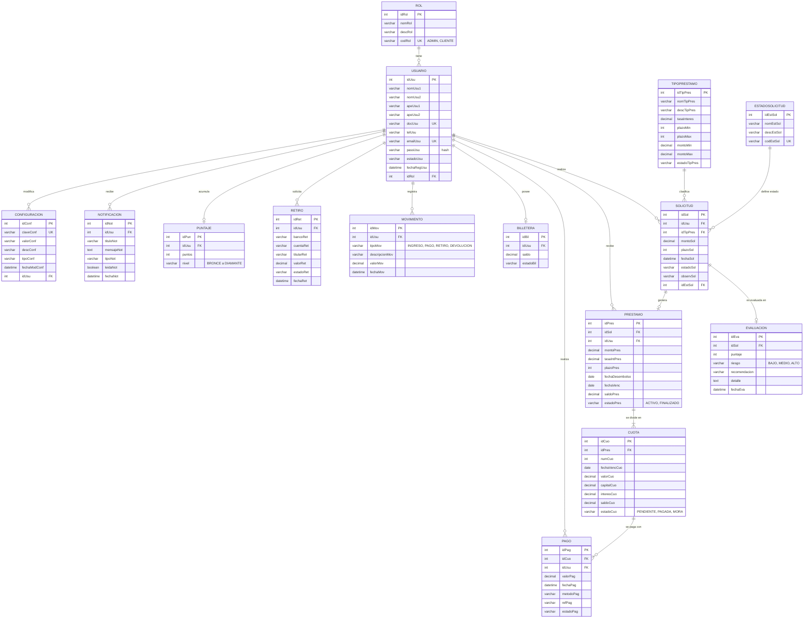

# 💰 JC Investments — Sistema Web Inteligente de Gestión de Préstamos

Sistema de información web que permite gestionar **solicitudes de préstamos de dinero** de forma rápida, segura y organizada: registro de clientes, solicitud y **evaluación inteligente** de préstamos, generación automática de cuotas, pagos, **billetera digital**, retiros a cuenta bancaria, puntaje por niveles y reportes administrativos.

🌐 **Demo en línea:** [jcinvestments.rf.gd/jc_investments](https://jcinvestments.rf.gd/jc_investments)

---

## 📑 Contenido

1. [Integrantes del proyecto](#-integrantes-del-proyecto)
2. [Idea de desarrollo web elegida](#-idea-de-desarrollo-web-elegida)
3. [Requerimientos funcionales (Épicas e Historias de usuario)](#-requerimientos-funcionales-épicas-e-historias-de-usuario)
4. [Requerimientos no funcionales (Definition of Done)](#-requerimientos-no-funcionales-definition-of-done)
5. [Requerimientos técnicos (Historias técnicas)](#️-requerimientos-técnicos-historias-técnicas)
6. [Modelado de la base de datos (Diagrama Entidad-Relación)](#️-modelado-de-la-base-de-datos-diagrama-entidad-relación)

---

## 👥 Integrantes del proyecto

| Integrante | Cargo | Responsabilidades principales |
|---|---|---|
| **Carlos Enrique Lizarazo** | Desarrollador Backend · Líder del proyecto | Diseño y administración de la base de datos, módulo de solicitudes, evaluación inteligente, generación de préstamos y cuotas, pagos, movimientos, billetera y panel administrativo. |
| **Juan José Pérez Arana** | Desarrollador Frontend · Líder del proyecto | Diseño de la interfaz (UI/UX), módulos visibles para clientes y administradores, diseño responsive con Tailwind CSS e integración de la interfaz con la lógica del sistema. |
| **Juan Manuel Cardona Patiño** | Desarrollador Full Stack | Desarrollo de lógica de negocio, integración de servicios, seguridad, autenticación y soporte en la conexión entre la base de datos y los módulos del sistema. |
| **Jesús Gabriel Ortiz Saac** | Desarrollador Frontend / QA | Construcción de componentes de interfaz, pruebas de calidad, validación de flujos de usuario y control de errores en el front-end. |
| **Brahian Alzate** | Desarrollador Backend | Apoyo en la creación de endpoints, estructuración de consultas, pruebas de servicios backend y documentación técnica del desarrollo. |

---|---|
| 1 | Carlos Enrique Lizarazo |
| 2 | Juan José Pérez Arana |
| 3 | Juan Manuel Cardona Patiño |
| 4 | Jesús Gabriel Ortiz Saac |
| 5 | Brahian Alzate |

---|---|---|
| **Carlos Enrique Lizarazo** | Desarrollador Backend · Líder del proyecto | Diseño y administración de la base de datos, módulo de solicitudes, evaluación inteligente, generación de préstamos y cuotas, pagos, movimientos, billetera y panel administrativo. |
| **Juan José Pérez Arana** | Desarrollador Frontend · Líder del proyecto | Diseño de la interfaz (UI/UX), módulos visibles para clientes y administradores, diseño responsive con Tailwind CSS e integración de la interfaz con la lógica del sistema. |

---

## 💡 Idea de desarrollo web elegida

### Sistema Web para la Gestión de Solicitudes de Préstamos de Dinero — *JC INVESTMENTS Web*

**Problema.** La empresa JC INVESTMENTS necesita optimizar la administración de sus préstamos. Hoy no cuenta con una plataforma que automatice las solicitudes, centralice la información de los clientes, controle la aprobación o rechazo de créditos, haga seguimiento a los pagos, genere reportes ni comunique a los clientes el estado de sus obligaciones.

**Solución.** Una aplicación web donde:

- El **cliente** se registra, solicita un préstamo según el tipo (monto, plazo y tasa definidos), consulta el estado de su solicitud, recibe el dinero aprobado en su **billetera digital**, paga sus cuotas, consulta sus movimientos y retira dinero a su cuenta bancaria.
- El sistema **evalúa automáticamente** cada solicitud con un puntaje de 0 a 100 y la clasifica en riesgo **BAJO / MEDIO / ALTO** con una recomendación (*Aprobar / Revisar / Rechazar*).
- Al aprobarse, el sistema **genera el préstamo, el plan de cuotas y el desembolso** a la billetera.
- El **administrador** gestiona usuarios, roles, tipos de préstamo, estados, solicitudes, pagos y retiros, y consulta reportes e indicadores.
- Un sistema de **puntaje por niveles** (Bronce → Plata → Oro → Platino → Diamante) premia el buen comportamiento de pago.

**Misión.** Brindar soluciones financieras accesibles, rápidas y seguras mediante una plataforma web innovadora que facilite la gestión de préstamos con transparencia y calidad en el servicio.

**Visión.** Ser una empresa líder en servicios financieros digitales, reconocida por la innovación tecnológica, la seguridad de la información y la excelencia en la gestión de préstamos.

**Actores:** 👤 Visitante · 🧑‍💼 Cliente · 🛡️ Administrador

---

## ✅ Requerimientos funcionales (Épicas e Historias de usuario)

> Formato: **Como** _[rol]_ **quiero** _[acción]_ **para** _[beneficio]_.
> Estado: ✅ Implementado · 🔄 En desarrollo
> Los códigos **CU** corresponden a los casos de uso del modelado UML del proyecto.

### 🧩 ÉPICA 1 — Sitio público e información (CU 1, CU 2, CU 3)

| ID | Historia de usuario | Criterios de aceptación | Estado |
|---|---|---|---|
| HU-01 | Como **visitante** quiero ver una página de inicio atractiva para conocer JC Investments y empezar mi solicitud. | Hero con propuesta de valor, botones **Solicitar ahora**, **Iniciar sesión** y **Registrarse**; menú de navegación; diseño responsive. | ✅ |
| HU-01.1 | Como **visitante** quiero ver los tipos de préstamo con su tasa, montos y plazos para comparar opciones. | Sección "Préstamos" con tarjetas cargadas desde `tipoprestamo`. | 🔄 |
| HU-02 | Como **visitante** quiero ver la sección "¿Cómo funciona?" para entender el proceso de solicitud. | Explica los pasos: registrarse, solicitar, evaluación, desembolso y pago. | 🔄 |
| HU-03 | Como **visitante** quiero enviar un mensaje desde "Contáctanos" para resolver mis dudas. | Formulario con validación de nombre, correo y mensaje; confirma el envío. | 🔄 |

### 🧩 ÉPICA 2 — Autenticación y cuenta (CU 1.1, CU 4, CU 5, CU 6)

| ID | Historia de usuario | Criterios de aceptación | Estado |
|---|---|---|---|
| HU-04 | Como **visitante** quiero registrarme con mis nombres, apellidos, documento, teléfono, correo y contraseña para poder solicitar préstamos. | Documento y correo únicos; contraseña cifrada con `password_hash`; el usuario queda con rol **Cliente** y estado **ACTIVO**. | ✅ |
| HU-05 | Como **usuario** quiero iniciar sesión con mi correo y contraseña para acceder a mi panel. | Solo usuarios ACTIVOS; muestra error si los datos son incorrectos; redirige al panel de **Cliente** o de **Administrador** según el rol. | ✅ |
| HU-06 | Como **usuario** quiero recuperar mi contraseña para no perder el acceso a mi cuenta. | Con su correo registrado define una nueva contraseña, que se guarda cifrada. | ✅ |
| HU-07 | Como **usuario** quiero cerrar sesión para proteger mi cuenta. | Destruye la sesión y redirige al login. | ✅ |
| HU-08 | Como **cliente** quiero ver y actualizar mi perfil (CU 1.1.5) para mantener mis datos al día. | Permite editar teléfono y correo validando que no estén repetidos. | 🔄 |

### 🧩 ÉPICA 3 — Solicitud y evaluación inteligente de préstamos (CU 1.1.2, CU 6.2)

| ID | Historia de usuario | Criterios de aceptación | Estado |
|---|---|---|---|
| HU-09 | Como **cliente** quiero solicitar un préstamo eligiendo tipo, monto y plazo para obtener financiación. | Registra la solicitud con su observación y la envía a evaluación automática. *(Pendiente: validar en el servidor que monto y plazo estén entre el mínimo y el máximo del tipo).* | ✅ |
| HU-10 | Como **sistema** quiero evaluar automáticamente cada solicitud para apoyar la decisión del administrador. | Calcula un puntaje 0–100; **≥ 80 → riesgo BAJO / APROBAR**, **≥ 60 → MEDIO / REVISAR**, **< 60 → ALTO / RECHAZAR**; guarda la evaluación. | ✅ |
| HU-11 | Como **cliente** quiero consultar el estado de mis solicitudes para saber si fueron aprobadas o rechazadas. | Muestra PENDIENTE, REVISION, APROBADA o RECHAZADA con la fecha. | ✅ |
| HU-12 | Como **administrador** quiero ver todas las solicitudes con su evaluación para gestionarlas. | Lista solicitudes con cliente, tipo, monto, plazo, estado, puntaje y riesgo. | ✅ |
| HU-13 | Como **administrador** quiero aprobar una solicitud para otorgar el préstamo. | Crea el préstamo, genera las cuotas mensuales, crea la billetera si no existe, desembolsa el monto y registra el movimiento **INGRESO**. | ✅ |
| HU-14 | Como **administrador** quiero rechazar una solicitud para negar préstamos de alto riesgo. | Cambia el estado a RECHAZADA. | ✅ |
| HU-15 | Como **cliente** quiero cancelar una solicitud antes de que sea aprobada para desistir del préstamo. | Solo se permite en estado PENDIENTE o REVISION. | 🔄 |

### 🧩 ÉPICA 4 — Préstamos, cuotas y pagos (CU 1.1.1, CU 1.1.3, CU 6.4)

| ID | Historia de usuario | Criterios de aceptación | Estado |
|---|---|---|---|
| HU-16 | Como **cliente** quiero ver un dashboard con mis préstamos, saldo y próximas cuotas para conocer mi situación. | Muestra saldo de billetera, préstamos activos, total adeudado y nivel. | ✅ |
| HU-17 | Como **cliente** quiero ver mis préstamos con su saldo y estado para controlar mi deuda. | Muestra monto, tasa, plazo, fechas, saldo y estado (ACTIVO / FINALIZADO). | ✅ |
| HU-18 | Como **cliente** quiero ver el plan de cuotas para saber cuánto y cuándo pagar. | Muestra número, fecha de vencimiento, valor, capital, interés, saldo y estado (PENDIENTE / PAGADA / MORA). | ✅ |
| HU-19 | Como **cliente** quiero pagar una cuota desde la plataforma para mantener mi crédito al día. | Registra el pago, marca la cuota como PAGADA y crea el movimiento **PAGO**. | ✅ |
| HU-20 | Como **cliente** quiero consultar mi historial de pagos. | Lista los pagos con fecha, valor, método y estado. | ✅ |
| HU-21 | Como **administrador** quiero registrar pagos manuales (efectivo, transferencia, Nequi, Daviplata, PSE) para reflejar pagos fuera de la plataforma. | Guarda método y referencia; actualiza cuota y saldo del préstamo. | ✅ |
| HU-22 | Como **administrador** quiero gestionar préstamos (crear, editar, eliminar) para corregir información. | CRUD completo de préstamos; al crear se generan sus cuotas. | ✅ |

### 🧩 ÉPICA 5 — Billetera digital y retiros

| ID | Historia de usuario | Criterios de aceptación | Estado |
|---|---|---|---|
| HU-23 | Como **cliente** quiero tener una billetera donde recibir el dinero aprobado para usarlo de inmediato. | Una billetera por cliente; el saldo aumenta con cada desembolso. | ✅ |
| HU-24 | Como **cliente** quiero ver los movimientos de mi billetera para controlar mi dinero. | Lista INGRESOS, PAGOS, RETIROS y DEVOLUCIONES con fecha y valor. | ✅ |
| HU-25 | Como **cliente** quiero solicitar un retiro a mi cuenta bancaria para disponer del dinero. | Pide banco, cuenta, titular y valor; no permite retirar más del saldo; descuenta el saldo, registra el movimiento **RETIRO** y queda PENDIENTE. | ✅ |
| HU-26 | Como **administrador** quiero aprobar o rechazar retiros para controlar la salida de dinero. | Al aprobar queda APROBADO; al rechazar se devuelve el valor a la billetera con un movimiento de devolución. | ✅ |

### 🧩 ÉPICA 6 — Puntaje y niveles (gamificación)

| ID | Historia de usuario | Criterios de aceptación | Estado |
|---|---|---|---|
| HU-27 | Como **cliente** quiero acumular puntos por mi buen comportamiento de pago para subir de nivel. | Niveles por puntos: **Bronce** (0), **Plata** (100), **Oro** (300), **Platino** (600), **Diamante** (1000). | ✅ |
| HU-28 | Como **sistema** quiero usar el historial del cliente en su score para premiar a los buenos pagadores. | Score entre 300 y 850: base 500, +50 por antigüedad (≥ 180 días), +5 por pago realizado, −30 por cuota en mora, −15 por préstamo activo. | ✅ |

### 🧩 ÉPICA 7 — Administración del sistema (CU 6.1, CU 6.3, CU 6.6)

| ID | Historia de usuario | Criterios de aceptación | Estado |
|---|---|---|---|
| HU-29 | Como **administrador** quiero un panel con indicadores para supervisar la operación. | Muestra total de usuarios, solicitudes, préstamos y pagos, solicitudes pendientes, total prestado y la lista de solicitudes recientes. | ✅ |
| HU-30 | Como **administrador** quiero gestionar usuarios (crear, listar, editar, eliminar) para controlar el acceso. | CRUD de usuarios con rol y estado. | ✅ |
| HU-31 | Como **administrador** quiero gestionar los roles del sistema. | CRUD de roles (ADMIN, CLIENTE). | ✅ |
| HU-32 | Como **administrador** quiero configurar los tipos de préstamo con su tasa, montos y plazos. | CRUD de tipos de préstamo con estado activo/inactivo. | ✅ |
| HU-33 | Como **administrador** quiero gestionar los estados de solicitud. | CRUD de estados de solicitud. | ✅ |
| HU-34 | Como **administrador** quiero modificar parámetros generales (tasa de mora, días de recordatorio) sin cambiar el código. | Usa la tabla `configuracion` y registra quién hizo el cambio. | 🔄 |

### 🧩 ÉPICA 8 — Reportes (CU 6.5)

| ID | Historia de usuario | Criterios de aceptación | Estado |
|---|---|---|---|
| HU-35 | Como **administrador** quiero un reporte de préstamos para analizar lo otorgado. | Lista préstamos con totales prestados y saldos. | ✅ |
| HU-36 | Como **administrador** quiero un reporte de pagos para conocer los ingresos. | Lista pagos con fecha, cliente, valor y método. | ✅ |
| HU-37 | Como **administrador** quiero un reporte de usuarios. | Lista usuarios con rol y estado. | ✅ |

### 🧩 ÉPICA 9 — Notificaciones (CU 1.1.4)

| ID | Historia de usuario | Criterios de aceptación | Estado |
|---|---|---|---|
| HU-38 | Como **cliente** quiero recibir notificaciones cuando cambie el estado de mi solicitud para estar informado. | Se crea una notificación al aprobar o rechazar; muestra indicador de no leídas. | 🔄 |
| HU-39 | Como **cliente** quiero recibir un recordatorio antes del vencimiento de mi cuota para no caer en mora. | Se genera según los días configurados en `DIAS_RECORDATORIO`. | 🔄 |

---

## 📏 Requerimientos no funcionales (Definition of Done)

Una historia de usuario se considera **TERMINADA (Done)** solo cuando cumple **todos** estos criterios:

### ✔️ Funcionalidad
- [ ] Cumple todos sus criterios de aceptación.
- [ ] Fue probada en el flujo correcto y en los casos de error (campos vacíos, valores fuera de rango, sesión vencida).
- [ ] No rompe funcionalidades que ya estaban terminadas.

### 🔒 Seguridad
- [ ] Contraseñas guardadas con `password_hash()` y validadas con `password_verify()`; nunca en texto plano.
- [ ] Cada página privada valida la sesión y el rol del usuario.
- [ ] Los datos de entrada se validan en el formulario **y** en el servidor; las salidas se escapan con `htmlspecialchars()`.
- [ ] Las consultas usan sentencias preparadas o datos escapados para evitar inyección SQL.
- [ ] Las credenciales de la base de datos **no** se publican en el repositorio.

### 💵 Integridad financiera
- [ ] Toda operación de dinero (desembolso, pago, retiro, devolución) actualiza el saldo **y** registra su `movimiento`.
- [ ] No se permiten montos negativos, en cero ni retiros mayores al saldo disponible.
- [ ] Los valores monetarios usan `DECIMAL`, no `FLOAT`.

### ⚡ Rendimiento
- [ ] Cada página carga en menos de **3 segundos** en el hosting de producción.
- [ ] Los listados extensos se pueden filtrar o paginar.

### 📱 Usabilidad y diseño
- [ ] Interfaz **responsive** (celular, tablet y computador) construida con **Tailwind CSS**.
- [ ] Mantiene la identidad visual del proyecto (tema azul oscuro) definida en los mockups.
- [ ] Mensajes de éxito y error claros y en español.
- [ ] Funciona en Chrome, Edge y Firefox actualizados.

### 🧹 Calidad del código
- [ ] Respeta la estructura por módulos (cliente, administrador, solicitudes, préstamos, pagos, reportes) y la convención de nombres `modulo_accion.php`.
- [ ] Sin errores de sintaxis (`php -l`) ni errores o advertencias en el navegador.
- [ ] Lógica compleja comentada (cálculo de cuotas, score, evaluación).

### 🔀 Control de versiones y despliegue
- [ ] Cambios subidos a GitHub con mensajes de commit descriptivos.
- [ ] Revisado por el otro integrante antes de integrarse a `main`.
- [ ] Desplegado y probado en el hosting (InfinityFree).

### 📄 Documentación
- [ ] Si cambia la base de datos, se actualizan el script SQL y el diagrama E-R.
- [ ] Los diagramas UML relacionados (casos de uso, robustez, secuencia, actividad) reflejan el cambio.

---

## 🛠️ Requerimientos técnicos (Historias técnicas)

### Stack tecnológico

| Capa | Tecnología |
|---|---|
| Frontend | HTML5, **Tailwind CSS**, JavaScript |
| Backend | **PHP 8** (procedural con extensión `mysqli`) |
| Base de datos | **MySQL / MariaDB** |
| Entorno local | XAMPP (Apache + MySQL + phpMyAdmin) |
| Hosting | InfinityFree (`jcinvestments.rf.gd`) |
| Modelado | draw.io (mockups, CU, robustez, secuencia, actividad, estados, clases, componentes, paquetes, dominio, E-R) |
| Control de versiones | Git + GitHub |

### Historias técnicas

> Formato: **Como** _equipo de desarrollo_ **necesitamos** _[tarea técnica]_ **para** _[objetivo]_.

| ID | Historia técnica | Criterios de aceptación | Estado |
|---|---|---|---|
| HT-01 | Como equipo necesitamos **diseñar el modelo de datos** (15 tablas) para soportar todos los módulos. | Diagrama E-R y script SQL de creación que se importa sin errores. | ✅ |
| HT-02 | Como equipo necesitamos una **conexión centralizada** a la base de datos para no repetir código. | Un único archivo `conexion.php` incluido por todos los módulos. | ✅ |
| HT-03 | Como equipo necesitamos **organizar el proyecto por módulos** para facilitar el mantenimiento. | Una carpeta por entidad/rol y archivos `modulo_listar / nuevo / guardar / editar / actualizar / eliminar`. | ✅ |
| HT-04 | Como equipo necesitamos **autenticación con sesiones y control de acceso por rol**. | `$_SESSION` con `idUsu` y `codRol`; cada panel bloquea accesos no autorizados. | ✅ |
| HT-05 | Como equipo necesitamos **cifrar las contraseñas** para proteger a los usuarios. | Uso de `password_hash(PASSWORD_DEFAULT)` y `password_verify()`. | ✅ |
| HT-06 | Como equipo necesitamos el **motor de evaluación inteligente** para clasificar el riesgo de cada solicitud. | Calcula puntaje, riesgo y recomendación y los guarda en `evaluacion`. | ✅ |
| HT-07 | Como equipo necesitamos el **cálculo del score crediticio** del cliente (`calcular_score.php`). | Score entre 300 y 850 basado en antigüedad, pagos, mora y préstamos activos. | ✅ |
| HT-08 | Como equipo necesitamos **generar el préstamo y su plan de cuotas** al aprobar una solicitud. | Se crean `plazo` cuotas con fecha de vencimiento mensual, capital, interés y saldo. | ✅ |
| HT-09 | Como equipo necesitamos que el **desembolso, el pago y el retiro** actualicen la billetera y registren el movimiento. | Cada operación deja trazabilidad en `movimiento`. | ✅ |
| HT-10 | Como equipo necesitamos el **sistema de niveles** a partir de los puntos del cliente. | `actualizar_puntaje.php` asigna Bronce, Plata, Oro, Platino o Diamante. | ✅ |
| HT-11 | Como equipo necesitamos **desplegar** el sistema en un hosting gratuito para que el profesor y los usuarios lo prueben. | Sitio publicado en InfinityFree con base de datos MySQL remota. | ✅ |
| HT-12 | Como equipo necesitamos ejecutar las operaciones de dinero dentro de **transacciones** (`mysqli_begin_transaction` / `commit` / `rollback`). | Si un paso falla, no quedan saldos ni cuotas inconsistentes. | 🔄 |
| HT-13 | Como equipo necesitamos migrar las consultas a **sentencias preparadas** (`mysqli_prepare`). | Ninguna consulta concatena directamente datos del usuario. | 🔄 |
| HT-14 | Como equipo necesitamos un **proceso diario** que marque cuotas en mora y genere recordatorios. | Script programado que actualiza `cuota.estadoCuo = 'MORA'` y crea registros en `notificacion`. | 🔄 |
| HT-15 | Como equipo necesitamos **documentar el sistema con UML** para respaldar el diseño. | Diagramas en draw.io: mockups, casos de uso, robustez, estados, actividad, secuencia, clases, componentes, paquetes, dominio y E-R. | ✅ |

---

## 🗄️ Modelado de la base de datos (Diagrama Entidad-Relación)

La base de datos `jc_investments` tiene **15 tablas** organizadas en 5 módulos:

| Módulo | Tablas |
|---|---|
| 👤 Usuarios y seguridad | `rol`, `usuario`, `configuracion` |
| 🏦 Crédito | `tipoprestamo`, `estadosolicitud`, `solicitud`, `evaluacion`, `prestamo`, `cuota`, `pago` |
| 💳 Billetera | `billetera`, `movimiento`, `retiro` |
| 🏆 Gamificación | `puntaje` |
| 🔔 Comunicación | `notificacion` |

### Relaciones y reglas de negocio

| Relación | Cardinalidad | Regla |
|---|---|---|
| Rol – Usuario | 1 : N | Cada usuario tiene un rol (ADMIN o CLIENTE). |
| Usuario – Solicitud | 1 : N | Un cliente puede hacer varias solicitudes. |
| TipoPrestamo – Solicitud | 1 : N | Cada solicitud corresponde a un tipo con tasa, montos y plazos límite. |
| Solicitud – Evaluación | 1 : 0..1 | Cada solicitud tiene como máximo una evaluación automática. |
| Solicitud – Préstamo | 1 : 0..1 | Solo una solicitud **APROBADA** genera un préstamo. |
| Préstamo – Cuota | 1 : N | Un préstamo se divide en tantas cuotas como meses de plazo. |
| Cuota – Pago | 1 : N | Una cuota puede recibir uno o varios pagos. |
| Usuario – Billetera | 1 : 0..1 | Cada cliente tiene una única billetera, creada al aprobarse su primer préstamo. |
| Usuario – Movimiento | 1 : N | Desembolsos, pagos, retiros y devoluciones quedan registrados. |
| Usuario – Retiro | 1 : N | Los retiros quedan PENDIENTES hasta que el administrador los aprueba o rechaza. |
| Usuario – Puntaje | 1 : 0..1 | Puntos y nivel del cliente. |

---

<b>JC Investments</b> · Proyecto académico de Ingeniería de Software · Universidad del Valle · 2026 
Carlos Enrique Lizarazo · Juan José Pérez Arana · Juan Manuel Cardona Patiño · Jesús Gabriel Ortiz Saac · Brahian Alzate

